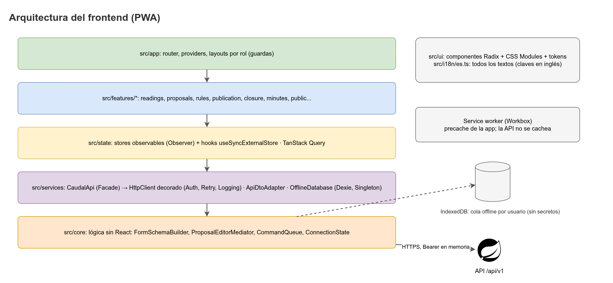

# CAUDAL Frontend

Aplicación web instalable (PWA) de **CAUDAL**, el cuaderno digital del acueducto veredal:

- **Fontanero:** registra la lectura del tanque desde el celular, también sin señal, y anota el cierre del día.
- **Junta:** ve el estado y el pronóstico del tanque, aprueba o modifica los turnos con motivo y publica el horario.
- **Familias:** consultan el horario sin datos personales y reportan daños.

React 19 · Vite · TypeScript · PWA sin conexión.



## Estado

**Fase 1 y 2: fundaciones.** Ya están la aplicación con Vite, las capas con ESLint, las pruebas con Vitest y MSW, el router por rol, los tokens de diseño, los textos en español, el cliente HTTP decorado y los formularios armados desde la API. Las pantallas se construyen por fases.

## Documentación

- [AGENTS.md](AGENTS.md): reglas obligatorias para personas y agentes.
- [`.agents/`](.agents/): arquitectura, pantallas, cola sin conexión, tema visual, seguridad, patrones y pruebas.
- Documentación canónica del proyecto: [`caudal-backend/docs`](https://github.com/NicoalsD/caudal-backend/tree/develop/docs).
- [Política de seguridad](SECURITY.md) y [cómo contribuir](CONTRIBUTING.md).

## Cómo correrlo

```bash
cp .env.example .env.local
pnpm install
pnpm dev          # http://localhost:5173
```

Verificación antes de cada commit:

```bash
pnpm lint
pnpm typecheck
pnpm test --run
pnpm build
```

Otros comandos: `pnpm format:check`, `pnpm test:coverage` y `pnpm gen:api` (tipos desde `docs/openapi.json`).

## Equipo

Nicolas Diaz (`NicoalsD`) · Drako Salazar (`Drako2305`) · Nicolas Mora (`nicomora70`). Proyecto de la materia Patrones de Software.
