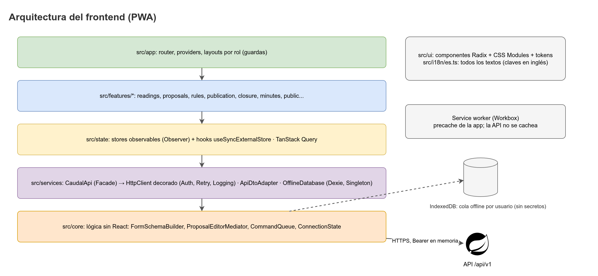

# CAUDAL Frontend

Aplicación web instalable (PWA) de **CAUDAL**, producto B2B para instituciones que almacenan agua en un tanque y la reparten por válvulas:

- **Superadmin de CAUDAL:** da de alta instituciones y su primer admin.
- **Admin de la institución:** configura el tanque, las líneas y las válvulas, calibra el sensor y administra usuarios, parámetros y piloto.
- **Operador:** ve el tanque en vivo, abre y cierra válvulas con confirmación, registra observaciones y cierra el día.
- **Lector:** consulta el tanque, el pronóstico, los eventos y las actas.

React 19 · Vite · TypeScript · PWA sin conexión.



## Estado

**v1.0.0** (versión anterior al alcance B2B): horario público, fontanero con cola sin conexión, Junta, equipo y entidades. El alcance **B2B** (2026-11-20) la reemplaza y su implementación está por hacer (Fase 4 del plan). Detalle de la v1.0.0 por actor, rutas y verificación en [docs/Version-1.0.0.md](docs/Version-1.0.0.md).

## Documentación

- [docs/Version-1.0.0.md](docs/Version-1.0.0.md): qué incluye la versión 1.0.0, rutas, verificación, despliegue y faltas del contrato de la API.
- [AGENTS.md](AGENTS.md): reglas obligatorias para personas y agentes.
- [`.agents/`](.agents/): arquitectura, pantallas, cola sin conexión, tema visual, seguridad, patrones y pruebas.
- Documentación canónica del proyecto: [`caudal-backend/docs`](https://github.com/NicoalsD/caudal-backend/tree/develop/docs).
- [Política de seguridad](SECURITY.md) y [cómo contribuir](CONTRIBUTING.md).

## Cómo correrlo

```bash
cp .env.example .env.local
pnpm install
pnpm dev          # http://localhost:5173
```

Verificación antes de cada commit:

```bash
pnpm format:check
pnpm lint
pnpm typecheck
pnpm test:coverage
pnpm build
```

Pruebas end-to-end (Playwright, con axe): `pnpm e2e:install` una vez y después `pnpm e2e`. Otros comandos: `pnpm gen:api` (tipos desde `docs/openapi.json`).

## Equipo

Nicolas Diaz (`NicoalsD`) · Drako Salazar (`Drako2305`) · Nicolas Mora (`nicomora70`). Proyecto de la materia Patrones de Software.
